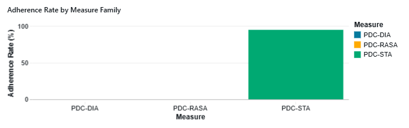
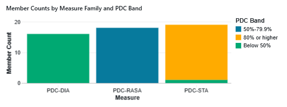
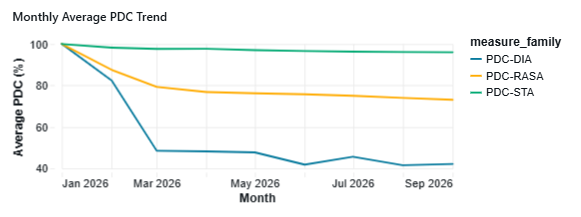
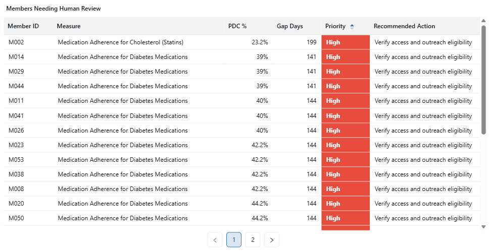
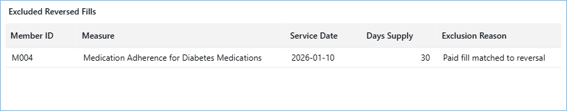

# Medicare Advantage Medication Adherence Analytics

A Databricks portfolio project analyzing synthetic pharmacy fills, enrollment windows, medication adherence, reversed fills, and member level review opportunities across a fictional Medicare Advantage style population.

Built with **Databricks, PySpark, Spark SQL, Delta tables, and Databricks SQL dashboards** to show how synthetic data can move from a Databricks notebook into reporting tables, a dashboard, and a clear audit trail.

> **Portfolio disclaimer:** This project uses synthetic data and fictional member, plan, medication, and prescription fill records. It was created independently for educational and portfolio purposes. It does not represent a healthcare organization, contain protected health information, implement official CMS Stars specifications, or provide clinical decision support.

## Project Overview

Medication adherence teams need a clear way to find members who may need review, compare results across measures, and see why data was included or excluded. This project uses fictional member, enrollment, medication, and prescription fill data to show that process.

The completed demo dataset contains:

- **55 fictional members**
- **3 medication measures**
- **2026 enrollment and prescription fill activity**
- Paid and reversed prescription fill events
- Diabetes, hypertension (RAS antagonist), and cholesterol (statin) medication categories
- Current PDC results, monthly PDC snapshots, a human review worklist, and a reversal audit

## Dashboard Preview

### 1. Adherence Rate by Measure

Compares the share of members meeting the 80% PDC demo threshold for each medication measure.

### 2. Member Counts by Measure and PDC Band

Shows how members are distributed below 50%, between 50% and 79.9%, or at/above 80% PDC.

### 3. Monthly Average PDC Trend

Tracks the average PDC percentage for each measure from January through September 2026.

### 4. Human Review Worklist

Identifies nonadherent demo members for human review using PDC, medication coverage gap days, priority, and a concise recommended action.

### 5. Reversed-Fill Audit

Shows paid fills removed from the simplified PDC calculation because the synthetic data contains a matching reversal, preserving a transparent audit trail.

## Key Performance Indicators

| KPI | Portfolio result |
|---|---:|
| Fictional members analyzed | 55 |
| Medication measures | 3 |
| Demo reporting cutoff | September 30, 2026 |
| Adherence threshold | 80% PDC |
| PDC bands displayed | 3 |
| Analytical output tables | 5 |
| Dashboard operational worklist | Member × measure |
| Reversal audit | Matched paid fill/reversal events |

## Key Findings

- The dashboard makes adherence performance comparable across diabetes, hypertension, and cholesterol medication families.
- Member level PDC bands distinguish high risk members below 50% PDC from members closer to the 80% demo threshold.
- The monthly PDC trend reveals how average medication coverage changes across the reporting period instead of relying only on a single cutoff date.
- The human review worklist gives staff a starting list for checking access and outreach eligibility.
- The reversed fill audit shows why an event was excluded, preventing canceled fills from inflating medication covered days.
- The results support human review. They do not trigger outreach, coverage, or clinical decisions automatically.

## Business Questions Addressed

1. Which medication measures have the strongest and weakest adherence performance?
2. How are members distributed across low, moderate, and adherent PDC bands?
3. Which members may need human review based on PDC and medication coverage gap days?
4. How has average PDC changed each month by medication measure?
5. Which paid fills were excluded because they had a matching reversal?
6. How can a quality operations team review medication adherence results with a transparent audit trail?

## Analytical Workflow

1. Generated a synthetic member, enrollment, medication, and prescription fill dataset using PySpark.
2. Created managed Delta tables in Databricks for the source data and analytical outputs.
3. Matched paid fills to reversals and excluded matched reversed fills before calculating medication coverage.
4. Expanded eligible paid fills into covered calendar days, constrained by enrollment dates and the reporting cutoff.
5. Calculated simplified Proportion of Days Covered (PDC) by member and medication measure.
6. Applied an 80% PDC demo threshold and created a prioritized human review worklist.
7. Built monthly PDC snapshots and Spark SQL queries for dashboard reporting.
8. Validated dashboard totals, measure labels, reversal exclusions, and worklist logic.
9. Exported the completed dashboard as a PDF for portfolio presentation.

## Dashboard Features

- Adherence rate comparison by medication measure
- Member distribution by PDC band: below 50%, 50%–79.9%, and 80% or higher
- Monthly average PDC trend by measure
- Human review worklist with PDC, gap days, priority, and recommended action
- Reversed fill audit table
- Full measure names in tables and abbreviated codes in charts for readability
- Dashboard refresh through Databricks SQL

## Tools and Skills Demonstrated

- **Databricks:** Notebook development, managed Delta tables, SQL datasets, and interactive dashboard development
- **PySpark:** Synthetic data generation, date logic, transformations, medication covered day expansion, and PDC calculations
- **Spark SQL:** Dashboard data retrieval, aggregation, ranking, and audit queries
- **Delta Lake:** Structured storage for source and reporting tables
- **Healthcare quality analytics:** Medication adherence, PDC, enrollment-aware coverage, fill reversals, and operational review workflows
- **Data quality and auditability:** Reversal matching, transparent exclusion reasons, and QA validation
- **Data storytelling:** Turning adherence results into population monitoring and review priorities

## Repository Files

| File | Description |
|---|---|
| [medicare_adherence_starter.py](notebooks/medicare_adherence_starter.py) | Databricks notebook source for synthetic data, transformations, and simplified PDC logic |
| [dashboard_queries.sql](sql/dashboard_queries.sql) | Spark SQL query pack used to build the dashboard tiles |
| [data_dictionary.xlsx](docs/data_dictionary.xlsx) | Field level reference for source and analytical tables |
| [KPI definitions](docs/kpi_definitions.md) | Definitions and intended interpretation of dashboard metrics |
| [Methodology](docs/methodology.md) | Calculation approach, assumptions, and limitations |
| [QA checklist](docs/qa_checklist.md) | Validation steps performed for the demo |
| [Dashboard PDF](docs/dashboard.pdf) | Exported dashboard for portable review |
| [assets/](assets/) | Dashboard preview images used in this README |

## How to View the Project

- Open the **Dashboard PDF** for a quick review of the completed Databricks dashboard.
- Review the dashboard preview images above for a fast overview directly within GitHub.
- Open the **Python notebook source** in Databricks to recreate the synthetic data and analytical tables.
- Run the **SQL query pack** in Databricks SQL to create or refresh the dashboard datasets.
- Use the data dictionary, KPI definitions, methodology, and QA checklist to understand the fields, measures, calculation logic, and validation approach.

## Important Notes and Limitations

- Every record is fabricated. No real patient, member, provider, pharmacy, or plan data is included.
- This is a simplified educational PDC model, not an official CMS Stars calculation.
- Official reporting would require current measure specifications, approved medication class mappings, full eligibility and exclusion rules, source transaction linkage, governance, and formal validation.
- Any outreach, care management, or operational action must be reviewed by an authorized human.

## Author

**Lisa A. Phillips, MBA**  
Healthcare Operations & Analytics | Commercial, Medicare & Medicaid | Business Intelligence

[LinkedIn](https://www.linkedin.com/in/lisaphillips106) · [GitHub](https://github.com/beachblondie106-coder)

